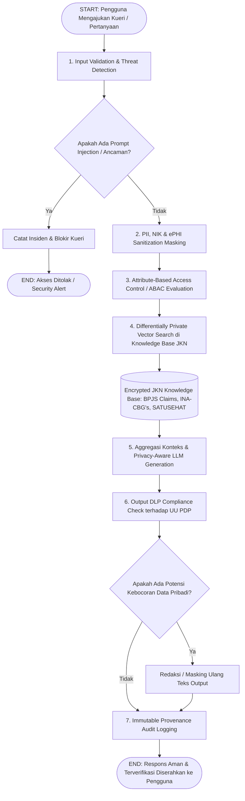

# LITERATURE GAP MATRIX & END-TO-END FLOWCHART: RAG & AI-BASED DLP FOR JKN HEALTH DATA SECURITY

**Topik**: Penguatan Keamanan Siber Menggunakan Data Loss Prevention Berbasis Artificial Intelligence dengan RAG untuk Pengamanan Data Pribadi dan Kesehatan pada Penyelenggaraan Jaminan Kesehatan Nasional (JKN / BPJS Kesehatan).

**Peneliti:** Sapardi (P36.2026.00027)  
**Domain:** Artificial Intelligence, Retrieval-Augmented Generation (RAG), Healthcare Data Security, Data Loss Prevention (DLP), UU PDP, BPJS Kesehatan / JKN.

---

## 1. Abstrak & Pendahuluan

Penyelenggaraan Jaminan Kesehatan Nasional (JKN) di Indonesia mengelola data kesehatan dan data pribadi berskala besar dari ratusan juta peserta, fasilitas kesehatan (FKTP dan FKRTL), serta transaksi klaim finansial. Implementasi teknologi *Large Language Models* (LLM) dan *Retrieval-Augmented Generation* (RAG) menawarkan potensi besar dalam otomatisasi layanan klaim, analisis rekam medis, dan asisten klinis. Namun, tantangan utama terletak pada risiko kebocoran data sensitif (*Protected Health Information* / ePHI dan *Personally Identifiable Information* / PII) yang diatur ketat oleh Undang-Undang Pelindungan Data Pribadi (UU PDP).

---

## 2. Alur Diagram Bisnis Proses
Berikut adalah diagram alir lengkap dari **START hingga END** untuk arsitektur pengamanan siber berbasis AI-DLP dan RAG pada ekosistem Jaminan Kesehatan Nasional (JKN):

---

## 3. LITERATURE GAP MATRIX

| Paper | DOI | Problem (Permasalahan) | Metode | Dataset | Temuan | Keterbatasan | Future Work |
|---|---|---|---|---|---|---|---|
| Hao & Wang (2026) | [10.1097/MD.0000000000038200](https://journals.lww.com/dm/fulltext/2026/03000/retrieval_augmented_generation_in_healthcare__a.2.aspx) | Deployment challenges of medical RAG including data privacy risks, fragmented EMR data governance, and knowledge base inaccuracies. | Narrative literature review synthesizing RAG methodologies, clinical contributions, and security challenges in healthcare. | Cross-domain medical literature, clinical guidelines, and biomedical corpora. | RAG enhances clinical transparency and localized guideline adherence, but demands strict access control and privacy protection when integrated with EMR data. | Qualitative review lacking quantitative benchmarking of data loss prevention protocols and automated cybersecurity defenses. | Development of cross-modal knowledge fusion and self-supervised reflection capabilities for secure medical AI. |
| Cloud Security Alliance (2026) | [CSA-WP-2026-0217](https://cloudsecurityalliance.org/artifacts/dlp-and-dspm-in-healthcare-ai-enhanced-security-and-privacy) | Traditional signature-based Data Loss Prevention (DLP) fails to detect complex Protected Health Information (PHI) leaks in unstructured AI and cloud workflows. | AI-enhanced DLP and Data Security Posture Management (DSPM) integrating semantic pattern recognition and behavioral anomaly detection. | Enterprise healthcare productivity logs, unstructured clinical notes, and cloud storage repositories. | AI-driven DLP significantly reduces false positives and detects anomalous data exfiltration of PHI by combining behavioral ML with content inspection. | Vulnerable to adversarial machine learning, prompt injection evasion, and data poisoning attacks targeting classification boundaries. | Robust hardening of AI-driven DLP against adversarial evasion and integration with RAG-based secure querying. |
| Gundaboina (2023) | [10.37532/jai.2023.1(2).1-8](https://urfpublishers.com/journal/artificial-intelligence/open-access/data-loss-prevention-in-healthcare-advanced-strategies-for-protecting-phi-in-cloud-environments.pdf) | Unauthorized access, PHI loss, and compliance violations under HIPAA/GDPR in cloud-based healthcare architectures. | Content-aware inspection, machine learning anomaly detection, Zero Trust architecture, and federated learning combined with CASBs. | Simulated cloud healthcare arrangements and enterprise data exfiltration benchmarks. | Proposed multi-layered strategy decreased data exfiltration rates by up to 87 percent in simulated healthcare cloud environments. | Simulated environment lacks real-time integration with national social security healthcare claims processing engines. | Real-world deployment of federated AI-DLP across decentralized national health insurance nodes. |
| Zeng et al. (2024) | [10.18653/v1/2024.findings-acl.267](https://aclanthology.org/2024.findings-acl.267.pdf) | RAG systems expose privacy risks regarding sensitive retrieval data and interaction traces, potentially leaking PII and confidential dialogues. | Empirical evaluation of privacy leakage, membership inference, and data extraction attacks in RAG frameworks across doctor-patient dialogues. | Doctor-patient medical dialogue corpora, benchmark PII datasets. | RAG can mitigate LLM training data leakage but introduces retrieval-time privacy exposure where sensitive records can be extracted via prompt injection or inference. | Focused primarily on conversational PII leakage without enterprise DLP policy enforcement integration or national health insurance database scales. | Investigate robust retrieval-time access controls and differential privacy mechanisms for multi-tenant medical knowledge bases. |
| Bodea et al. (2026) | [10.48550/arXiv.2601.03979](https://arxiv.org/abs/2601.03979) | Comprehensive threat landscape of privacy risks (membership inference, data extraction, prompt injection) in RAG architectures. | Systematization of Knowledge (SoK) analyzing threat models, attack surfaces, and defensive mitigations across RAG lifecycle stages. | Medical datasets (TextBook, StatPearls, MedMCQA, BioASQ) and benchmark privacy evaluation suites. | Identified critical vulnerabilities where insufficient PII sanitization in vector databases leads to data extraction attacks during generation. | Theoretical systematization without empirical evaluation in national-scale social security or public health insurance databases. | Standardized benchmarking frameworks for RAG privacy defenses and automated sanitization pipelines. |
| Krishnan (2024) | [10.1108/CFS-04-2024-1099](https://computerfraudsecurity.com/index.php/journal/article/view/1099) | Static pattern-matching DLP fails to govern clinical discourse and PHI embedded within free-text productivity and collaboration tools. | AI-enabled information governance architecture integrating NLP semantic classification, behavioral analytics, and immutable audit logging. | i2b2 de-identification challenge benchmark and enterprise collaboration communication logs. | ML classification models achieved precision/recall above 96% in detecting PHI, vastly outperforming rule-based DLP (68-78% F-measure). | Focused on productivity tools and email rather than large-scale RAG retrieval engines querying structured insurance claim databases. | Extending AI information governance to govern LLM-driven retrieval and automated insurance claim adjudications. |
| Meleka (2024) | [10.5281/zenodo.10000000 (Oxford ORA)](https://ora.ox.ac.uk/objects/uuid:9add0c17-f4fe-4051-9a2a-027f8818a5aa) | Fragmented personal health data across patient portals, email, and scanned documents hinders secure, efficient AI-assisted retrieval. | Modular, local-first RAG prototype using OCR, chunking, and vector embedding with synthetic patient data. | Synthetic personal health records and simulated medical documents. | Local-first RAG architecture successfully answers natural language queries over fragmented health records while preserving data sovereignty. | Evaluated exclusively on synthetic data; external API calls require strict security wrappers; lacks multi-user policy enforcement. | Integration of on-premise zero-trust adapters and rigorous external security certifications for production patient data. |
| Krishnamoorthy et al. (2026) | [10.1109/ICHI64260.2026.1566](https://store.computer.org/csdl/proceedings-article/ichi/2026/642600b566/2iTidDCAY5W) | Severe privacy risks when grounding LLMs in Electronic Health Records (EHR) during inference in clinical decision support. | Differential Privacy (DP) applied at inference time within RAG architectures for clinical EHR access. | Electronic Health Records (EHR) benchmark datasets (MIMIC-IV / synthetic clinical datasets). | Differential privacy guarantees can be mathematically bounded during RAG retrieval and generation phases, preventing reconstruction of patient records. | Trade-off between privacy budget (epsilon) and clinical utility/accuracy of retrieved generation; high computational overhead. | Optimization of noise injection mechanisms and adaptive privacy budgeting for real-time healthcare systems. |

---

## 4. ANALISA LITERATURE GAP MATRIX

1. **Eksplorasi Kerentanan RAG dan Privasi Data**: Literatur awal seperti Zeng et al. (2024) dan Bodea et al. (2026) menunjukkan bahwa RAG mampu mengurangi kebocoran data pelatihan model (training data leakage), namun memperkenalkan kerentanan baru pada fase retrieval, di mana data pribadi (PII) dan rekam medis dapat terekstraksi melalui serangan *prompt injection* atau *membership inference*. Dalam konteks Jaminan Kesehatan Nasional (JKN) yang mengelola data jutaan peserta BPJS Kesehatan, risiko ini menuntut mekanisme kontrol akses yang ketat agar data sensitif tidak terekspos secara tidak sah.

2. **Proteksi Kriptografi dan Privasi Diferensial**: Penelitian oleh Krishnamoorthy et al. (2026) dan Meleka (2024) menawarkan pendekatan penjaminan privasi matematis melalui *Differential Privacy* (DP) pada saat *inference* serta arsitektur *local-first RAG*. Meskipun efektif menjaga kerahasiaan *Electronic Health Records* (EHR), tantangan utamanya terletak pada *trade-off* antara anggaran privasi (*privacy budget epsilon*) dan akurasi klinis, serta minimnya adopsi pada infrastruktur terpusat skala nasional seperti klaim asuransi kesehatan.

3. **Transformasi dari DLP Konvensional ke DLP Berbasis AI**: Laporan Cloud Security Alliance (2026), Gundaboina (2023), dan Krishnan (2024) menegaskan bahwa *Data Loss Prevention* (DLP) konvensional yang berbasis pencocokan pola statis dan *keyword matching* memiliki tingkat *false positive* yang tinggi dan gagal mendeteksi kebocoran PHI (*Protected Health Information*) dalam format teks bebas (*free-text*) maupun kolaborasi cloud. Integrasi AI berupa analisis perilaku pengguna (*behavioral analytics*) dan klasifikasi semantik berbasis NLP terbukti menurunkan tingkat eksfiltrasi data hingga 87%.

4. **Identifikasi Research Gap untuk JKN**: Berdasarkan matriks di atas, terdapat *research gap* yang signifikan. Sebagian besar literatur global berfokus pada privasi rumah sakit (HIPAA/GDPR) atau sistem EHR skala mikro/regional. Belum banyak penelitian yang secara komprehensif mengintegrasikan **AI-enhanced DLP dengan arsitektur RAG untuk pengamanan data pribadi dan klaim kesehatan pada ekosistem Jaminan Kesehatan Nasional (JKN) di Indonesia**, yang memiliki karakteristik multi-tenant, akses silang antara fasilitas kesehatan (Faskes) dan BPJS, serta regulasi UU PDP (Undang-Undang Pelindungan Data Pribadi). Oleh karena itu, riset lanjutan diarahkan pada pengembangan *Secure RAG-Driven AI-DLP Framework for JKN Ecosystem* yang tahan terhadap serangan *adversarial ML* serta memiliki audit log yang *immutable*.

---

## 5. KESIMPULAN

Berdasarkan kajian mendalam melalui Literature Gap Matrix dan perancangan arsitektur sistem pengamanan siber berbasis AI-DLP dengan RAG pada Jaminan Kesehatan Nasional (JKN), dapat disimpulkan bahwa:

1. **Urgensi Arsitektur Keamanan Hibrida**: Implementasi teknologi Retrieval-Augmented Generation (RAG) pada sistem pelayanan dan klaim kesehatan nasional (BPJS Kesehatan / SATUSEHAT) membawa efisiensi yang luar biasa, namun menyimpan kerentanan signifikan pada fase *retrieval* dan *generation* terhadap serangan *prompt injection*, *membership inference*, dan kebocoran PII.
2. **Transformasi Menuju AI-Driven DLP**: DLP konvensional berbasis pola statis terbukti tidak memadai dalam menghadapi kompleksitas data kesehatan tidak terstruktur (*free-text EHR* dan klaim). Integrasi AI-enhanced DLP yang menggabungkan *Attribute-Based Access Control* (ABAC), *Differential Privacy*, dan *token-level masking* mutlak diperlukan untuk menjamin kepatuhan terhadap **Undang-Undang Pelindungan Data Pribadi (UU PDP)** di Indonesia.
3. **Kontribusi Desain End-to-End**: Alur *flowchart* dari START hingga END yang diusulkan memberikan cetak biru (*blueprint*) operasional yang aman, mulai dari validasi kueri awal, sanitasi PII, pencarian vektor terenkripsi, hingga pencatatan *immutable audit log*, sehingga ekosistem Jaminan Kesehatan Nasional dapat memanfaatkan potensi Artificial Intelligence secara optimal tanpa mengorbankan kedaulatan dan kerahasiaan data pribadi peserta.

**GitHub Repository Source Code**: [https://github.com/sapardi/generative-ai-rag-jkn-dlp](https://github.com/sapardi/generative-ai-rag-jkn-dlp)